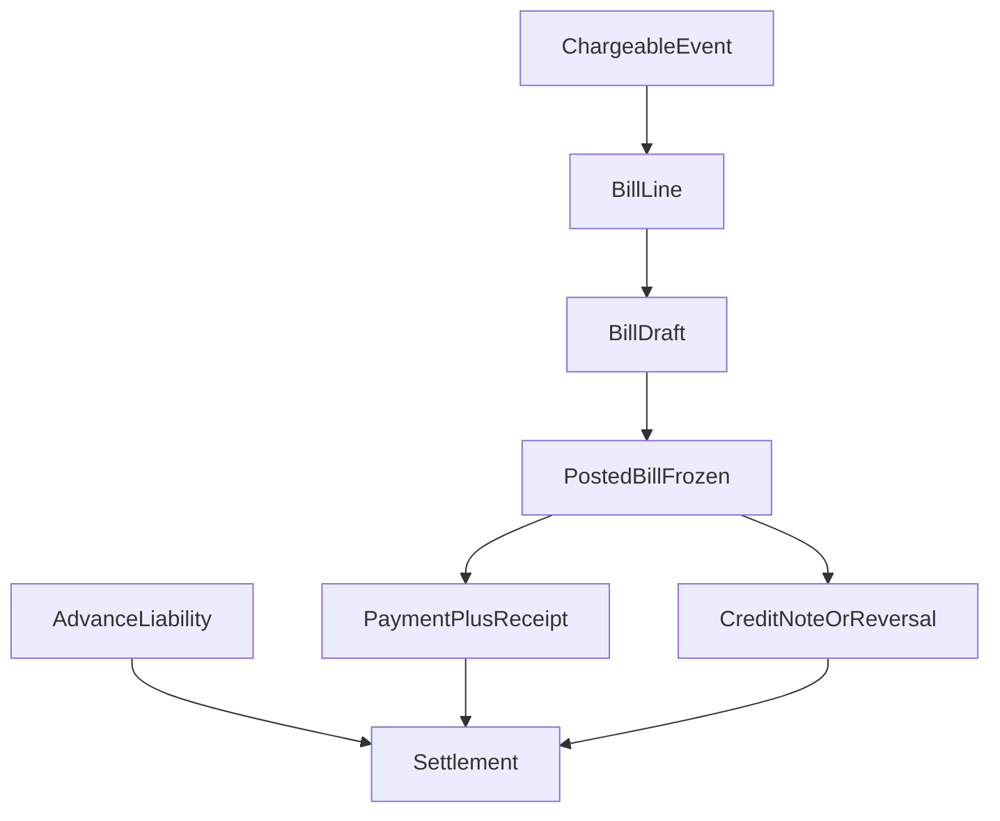
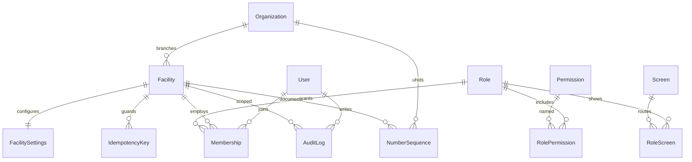

# HIMS Architecture

Hospital Information Management System for small and mid-size hospitals (20–200 beds). India-first (GST, TDS, DPDP-oriented consent hooks), multi-facility ready.

**Phase:** 3 (Billing engine)  
**Reference:** Indus HMS (Health4U) field catalogs in the workspace root (`hms_indus_*.docx`).

## Locked decisions

| Topic | Choice |
|---|---|
| Tax | India GST (CGST+SGST / IGST) + TDS on commissions. Rates unconfirmed until a CA reviews. |
| Scale | One facility ~180 beds now; second facility expected within a year. |
| Pilot roles | Super Admin, Facility Admin, Receptionist, Cashier, Doctor. |
| Stack | Django 5.2 LTS + DRF, PostgreSQL 16, Redis, Celery, React + TypeScript (Vite), TanStack Query, Tailwind, shadcn/ui. |
| Auth | Server session + CSRF. Argon2 passwords. Optional TOTP (required for Super Admin and Doctor). JWT deferred to Phase 10 portal. |
| Hosting | Native local development on Windows (PostgreSQL service, Python venv, Vite). Docker is not required on this machine and its files are optional. No cloud/Nginx/TLS until requested. |

## Assumptions

- Demo tenant: organization **Demo Hospital Group**, facility **Demo Multi-Speciality Hospital**, GST state code **36** (Telangana), FY start **1 April**, timezone `Asia/Kolkata`, currency INR.
- Patient and lifelong UHID belong to the **organization**. Visits, bills, admissions, stock, and receipts belong to a **facility**.
- Bill and receipt numbers are gap-free per facility per financial year. UHID is gap-free per organization and does not reset each year.
- Allocations run inside the same DB transaction as the document insert (`SELECT FOR UPDATE` on the sequence row).
- Local Postgres is not encrypted at rest; dev is HTTP on localhost. Real patient data waits for disk encryption and TLS.
- Indian invoice rounding is half-up to paise (`Decimal`). GST is calculated in `post_bill` and applied only when `gstin_confirmed` is true.

## Module boundaries

Django apps under `backend/apps/`. Views validate and call services. Services own rules. Models do not contain billing or stock math.

| App | Responsibility |
|---|---|
| `common` | Base models, money helpers, API errors, idempotency keys, request id middleware |
| `organizations` | Organization, Facility, FacilitySettings |
| `accounts` | User, Role, Permission, Membership, Screen grants, session auth, TOTP |
| `audit` | Append-only AuditLog + PostgreSQL immutability trigger |
| `numbering` | NumberSequence and `allocate()` |
| `billing` | Empty package in Phase 0; owns future billing engine contracts |

Later phases add: `masters`, `patients`, `opd`, `clinical`, `pharmacy`, `laboratory`, `radiology`, `ipd`, `accounting`, `reports`, `integration` (FHIR).

## Billing engine (Phase 3)

Every chargeable event creates `BillLine` rows on a shared `Bill` with `source_type` / `source_id`. Cancellation, refund, advance, discount approval, due collection, and day close are implemented once. Posted bills, lines, payments, receipts, credit notes, and commission rows are append-only.



- Statuses: Draft → Posted → Partially Paid → Paid. Cancelled / Refunded mean a reversal or refund document exists; the original row stays.
- Money: `Decimal(14,2)`. Hospital share and doctor share on each line.
- Discount above role limit stays unposted until authorized.
- Refund above `FacilitySettings.refund_auth_threshold` requires authorization.
- GST fields live on facility now; tax categories and HSN/SAC arrive with charge masters (Phase 1); calculation in Phase 3.
- TDS: `tds_commission_rate` + `tds_rate_confirmed`. Commission math runs only after an accountant confirms the rate.
- Payments use idempotency keys. Posted financial records are never updated or deleted.

## Number formats

| Kind | Owner | Format | Resets |
|---|---|---|---|
| UHID / MR | Organization | `{org_code}/MR/{seq:06d}` | Never |
| Facility docs | Facility | `{facility_code}/{type}/{fy}/{seq:06d}` | Each FY |

Document types: `BILL`, `RCPT`, `VISIT`, `IP`, `LAB`, `RAD`, `ADV`, `REF`, `CN`.  
Financial year label example: `2026-27` (FY starts 1 April).

**Invariant:** callers must call `allocate()` inside the same database transaction as the document insert. Allocating outside that transaction burns numbers on rollback.

## Auth and RBAC

- Custom user (username + password), Argon2 hasher.
- Session cookie + CSRF. Idle timeout from facility settings (default 30 minutes).
- Login throttle: 5 failures per username and IP per 15 minutes.
- TOTP optional; facility policy requires it for Super Admin and Doctor.
- Membership: `(user, facility, role)`. Active facility stored on the session.
- Permissions: `module.action` rows. Screens: `Screen` + `RoleScreen` (replaces legacy User Screen Settings).
- Report catalog visibility is Phase 0 data readiness only; report execution is Phase 9.

### Roles (14)

Super Admin, Facility Admin, Receptionist, Cashier/Billing, Doctor, Nurse, Lab Technician, Lab Pathologist/Authorizer, Radiology Technician, Radiologist, Pharmacist, Store Keeper, Accountant, Manager.

Phase 0 seeds all roles; only the five pilot roles have users and Phase 0 screens.

## Audit

`audit.record()` writes every create, update, login, logout, permission change, settings change, and sensitive read.

Fields: actor, facility, action, entity type/id, before/after JSON, IP, user agent, request id, timestamp.

PostgreSQL trigger rejects `UPDATE` and `DELETE` on `audit_log`. The migration is reversible.

## Soft delete and multi-facility

Clinical and financial tables (from Phase 2 onward) use soft delete (`deleted_at`). Every facility-scoped table carries `facility_id`. Patient is the documented exception (organization-scoped).

## Folder structure

```
Software/
  ARCHITECTURE.md
  README.md
  .env.example
  docker-compose.yml     # optional, not used for local Windows dev
  scripts/
    dev.ps1               # starts backend + frontend natively
  backend/
    manage.py
    hims/                 # Django project settings
    apps/
      common/
      organizations/
      accounts/
      audit/
      numbering/
      billing/            # empty package Phase 0
    tests/
  frontend/
    src/
  docs/
    phase-0-demo.md
  .github/workflows/ci.yml
```

## Phase 0 ER



`NumberSequence` has exactly one owner: organization for UHID, facility for every other series.  
`Role.facility` null means a system template copied per facility on seed.

## Security (Phase 0)

- Argon2 passwords; session CSRF; rate-limited login; optional TOTP.
- Secrets via environment only.
- Seed refuses to run when `DEBUG` is false.
- OWASP-minded defaults: no secrets in code, structured logging, health checks.

## Non-goals for Phase 0

Patients, tariffs, bills, GST math, clinical data, lab, pharmacy, IPD, report execution, Nginx, TLS, cloud deploy, JWT, ABDM/ABHA.

## Phase roadmap (summary)

| Phase | Focus |
|---|---|
| 0 | Foundation (this document) |
| 1 | Masters (departments through geography; editable at `/masters`) |
| 2 | Patient and OPD |
| 3 | Billing engine |
| 4 | Clinical EMR (notes, ICD, Rx alerts, orders, timeline at `/emr`) |
| 5 | Pharmacy and inventory |
| 6 | Laboratory (LIS) |
| 7 | Radiology |
| 8 | In-Patient |
| 9 | Accounting, reports, dashboards |
| 10 | Insurance, OT, portal, ABDM, AI-assist |

## Risks

- Session + Vite proxy CSRF: verified in the browser on native Windows (login, user create, cashier 403).
- Gap-free numbering depends on transactional `allocate()` usage.
- Unconfirmed GST and TDS are a go-live blocker, not a Phase 0 blocker.
